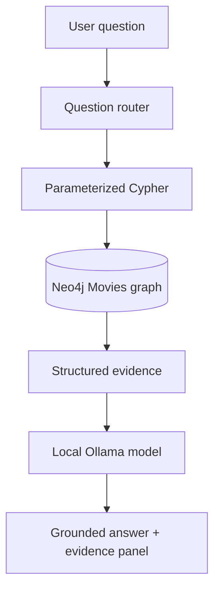

# CineGraph AI — Local Ollama Edition

**Graph RAG Movie Assistant powered by Neo4j, Ollama, and Streamlit.**

CineGraph AI routes natural-language movie questions to predefined parameterized Cypher queries, retrieves real records from your Neo4j Movies graph, then asks a locally running Ollama model to generate an evidence-grounded response. No paid LLM API key is required.

## Features

- Natural-language questions about movies, actors, directors, and collaborations
- Parameterized Cypher retrieval and evidence transparency
- Local Ollama answer generation
- Graph exploration, movie discovery, and graph-based recommendations
- System status and troubleshooting guidance
- Fallback answers when Ollama is unavailable

## Requirements

- Python 3.13 (compatible code)
- Neo4j AuraDB or local Neo4j with the Movies sample graph loaded
- Ollama installed and running locally: https://ollama.com/download

## 1. Install and download a model

Install Ollama, then open PowerShell and run:

```powershell
ollama pull llama3.2:3b
ollama list
```

The model download can take time. `llama3.2:3b` is a lightweight starting point. You can choose another model and set its exact name in `OLLAMA_MODEL`.

## 2. Configure Neo4j and Ollama

Create `.env` from the template:

```powershell
Copy-Item .env.example .env
```

Edit `.env` and enter your existing Neo4j credentials. Ollama defaults to `http://localhost:11434`; no Ollama API key is required for local use. Example settings:

```env
LLM_PROVIDER=ollama
OLLAMA_HOST=http://localhost:11434
OLLAMA_MODEL=llama3.2:3b
```

**Important:** creating a Neo4j instance and loading the Movies sample dataset are separate steps. Follow `docs/database_setup.md` and confirm the graph has movie/person nodes and relationships.

## 3. Install and run on Windows PowerShell

From the extracted `CineGraph_AI` folder:

```powershell
py -3.13 -m venv .venv
.\.venv\Scripts\Activate.ps1
python -m pip install --upgrade pip
pip install -r requirements.txt
Copy-Item .env.example .env
python -m streamlit run app.py
```

If PowerShell blocks activation, run `Set-ExecutionPolicy -Scope Process -ExecutionPolicy Bypass`, then activate the environment again. If `.env` already exists, do not overwrite your credentials with the template.

## 4. Test

```powershell
python -m pytest -v
```

## Example questions

- Who directed The Matrix?
- Which movies did Tom Hanks act in?
- Which actors worked with Christopher Nolan?
- Which movies feature both Tom Hanks and Meg Ryan?
- Recommend movies related to The Matrix.
- Why is this movie recommended?

## Architecture



Neo4j is the source of graph facts. Ollama generates natural-language responses from retrieved records; it should not be treated as a source for unsupported movie facts.

## Troubleshooting

- `ollama` command not found: install Ollama and reopen the terminal.
- Connection refused: start the Ollama application/service and verify `OLLAMA_HOST`.
- Model not found: run `ollama pull llama3.2:3b` and ensure `OLLAMA_MODEL` matches `ollama list`.
- Slow responses: use a smaller model or reduce `MAX_RESULTS`.
- Empty graph results: confirm the Movies dataset is loaded and inspect the evidence panel.

## Security and limitations

`.env` is excluded from Git. Do not commit database passwords. Local inference avoids per-request cloud API charges, but model speed and quality depend on your hardware. The app retrieves facts using predefined query templates and uses a deterministic graph-based recommendation baseline; it does not claim to use embeddings or ratings unless implemented.


### UI update
Movie Discovery has been removed because its functionality overlaps with Recommendations. The graph explorer draws each relationship between its actual Neo4j endpoint node IDs and labels each edge with the stored relationship type.
