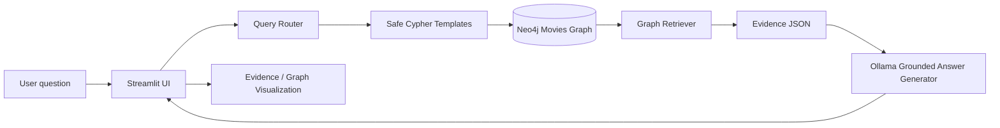

# CineGraph AI Architecture

The router selects only predefined parameterized Cypher templates. Neo4j is the source of graph facts; The local Ollama model receives retrieved evidence and is instructed not to invent unsupported facts.

## Supported question types (query router)

Keyword rules in `rag/query_router.py` map a question to one allow-listed template in
`rag/cypher_templates.py`. The Ollama classifier is only consulted when no rule matches.

| Area | Example questions | Category |
|---|---|---|
| Cast of a movie | "List the actors of X", "Who is in X?", "X cast" | `cast_discovery`, `cast_size` |
| Crew / all credits | "Who worked on X?", "Cast and director of X", "Who produced and directed X?" | `movie_relationships` |
| Director / producer / writer / reviewer | "Who directed X?", "Who wrote X?" | `director_lookup`, `producer_lookup`, ... |
| A person's movies | "Tom Hanks movies", "Movies starring X", "X filmography" | `actor_lookup`, `person_movies_any` |
| Release-year filters | "Movies from the 90s", "after 2000", "oldest movie" | `movies_between`, `oldest_movies`, `newest_movies` |
| Co-workers | "Who has X worked with?", "Movies with both X and Y" | `actor_collaborations`, `shared_movie` |
| Cross-role | "Which directors has X worked with?", "Which actors did D direct?", "Who both acted in and directed?" | `actor_directors`, `director_actors`, `actor_directors_overlap` |
| Counts and rankings | "How many movies are in the database?", "Which actor appeared in the most movies?", "Largest cast" | `database_counts`, `top_actors`, `largest_casts`, `person_movie_count` |
| Ratings | "Rating of X", "What rating did P give X?", "Highest rated movies" | `movie_rating`, `reviewed_check`, `top_rated_movies` |
| Yes/no checks | "Did X produce Y?" | `*_check` |
| Recommendations | "Recommend movies like X" | `recommendations` |

Not supported: birth dates, character roles and follow links (removed because the project never confirmed those fields exist in the graph), genre questions, streaming availability,
and free-form multi-hop questions that need a query not listed above.
