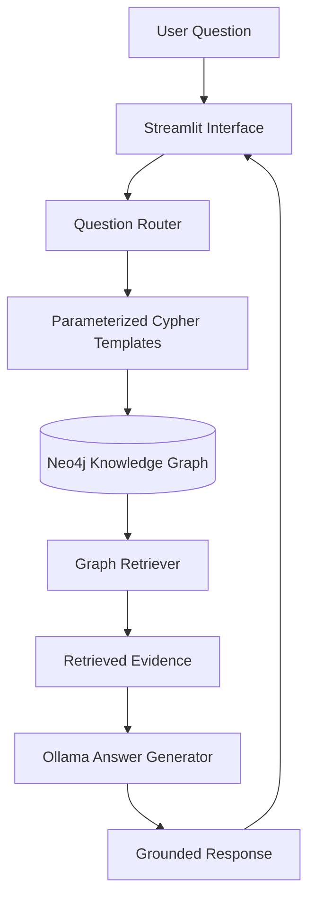

# 🎬 CineGraph AI — Graph RAG Movie Assistant

**Explore movies, discover relationships, and get evidence-based answers using Knowledge Graphs and Generative AI.**

CineGraph AI is an interactive movie exploration application that combines **Retrieval-Augmented Generation (RAG), Neo4j, Ollama, and Streamlit** to answer natural-language questions using a movie knowledge graph.

Instead of relying solely on an LLM's pretrained knowledge, the system retrieves relevant movie and person relationships from Neo4j and uses the retrieved evidence to generate answers.

## ✨ Features

- **AI Movie Companion:** Ask natural-language questions about movies, actors, directors, producers, writers, and reviewers.
- **Graph-Based Retrieval:** Retrieve movie information using predefined, parameterized Cypher queries.
- **Yes/No Question Handling:** Check relationships, such as whether a person acted in, directed, produced, or reviewed a movie.
- **Question Coverage:** Route different natural-language phrasings to appropriate query templates.
- **Graph Explorer:** Visualize movie-person connections and explore relationships stored in Neo4j.
- **Movie Recommendations:** Discover related movies using shared actors and directors.
- **Evidence-Grounded Answers:** Generate responses from retrieved graph records rather than unsupported model assumptions.
- **Local LLM Integration:** Use Ollama for local inference without requiring a paid LLM API key.
- **Automated Tests:** Validate query routing, answer grounding, recommendation explanations, and environment configuration.

## 🛠️ Tech Stack

| Technology | Purpose |
|---|---|
| Python | Core application logic |
| Streamlit | Interactive web interface |
| Neo4j | Movie knowledge graph database |
| Cypher | Graph querying and relationship retrieval |
| Ollama | Local LLM inference |
| PyVis | Graph visualization |
| Plotly | Interactive visualizations |
| Pytest | Automated testing |

## 🏗️ System Architecture



## ⚙️ Installation and Setup

### Prerequisites

- Python 3.13
- Neo4j AuraDB or a local Neo4j instance
- Ollama installed on your machine

### 1. Clone the repository

```bash
git clone <your-repository-url>
cd CineGraph_AI
```

Replace `<your-repository-url>` with your GitHub repository URL.

### 2. Create and activate a virtual environment

**Windows PowerShell**

```powershell
py -3.13 -m venv .venv
.\.venv\Scripts\Activate.ps1
```

### 3. Install dependencies

```bash
python -m pip install --upgrade pip
pip install -r requirements.txt
```

### 4. Configure environment variables

Create a `.env` file from the provided template:

```powershell
Copy-Item .env.example .env
```

Update `.env` with your Neo4j connection details:

```env
NEO4J_URI=neo4j+s://your-instance.databases.neo4j.io
NEO4J_USERNAME=neo4j
NEO4J_PASSWORD=your-password

LLM_PROVIDER=ollama
OLLAMA_HOST=http://localhost:11434
OLLAMA_MODEL=llama3.2:3b

MAX_RESULTS=20
DEBUG_MODE=false
```

**Important:** Load the Neo4j Movies sample graph into your database and verify its relationships. Creating an AuraDB instance alone does not populate the graph.

See [`docs/database_setup.md`](docs/database_setup.md) for detailed instructions.

### 5. Download the Ollama model

```bash
ollama pull llama3.2:3b
```

Ensure Ollama is running before launching the application.

### 6. Run the application

```bash
python -m streamlit run app.py
```

Open the local URL displayed in your terminal, usually `http://localhost:8501`.

## 🧪 Run Tests

Run the automated test suite from the project directory:

```bash
python -m pytest -v
```

The tests cover question routing, supported query templates, answer grounding, recommendation explanations, and environment configuration.

## 📁 Project Structure

```text
CineGraph_AI/
├── app.py
├── components/
│   ├── chat_interface.py
│   ├── graph_visualizer.py
│   ├── movie_cards.py
│   ├── sidebar.py
│   └── styling.py
├── config/
│   └── settings.py
├── database/
│   ├── neo4j_connection.py
│   ├── schema_inspector.py
│   └── setup_queries.cypher
├── rag/
│   ├── answer_generator.py
│   ├── conversation.py
│   ├── cypher_templates.py
│   ├── graph_retriever.py
│   ├── query_router.py
│   └── recommendation_engine.py
├── pages/
│   ├── 1_AI_Companion.py
│   ├── 2_Graph_Explorer.py
│   ├── 4_Recommendations.py
│   └── 5_System_Status.py
├── tests/
├── docs/
├── assets/
├── .env.example
├── .gitignore
├── requirements.txt
└── README.md
```

## 🔐 Security

- Keep database credentials in `.env`.
- Never commit `.env` or other files containing secrets.
- Use `.env.example` to document the required configuration variables.
- Keep virtual environments and Python cache files out of version control.

## ⚠️ Limitations

- Answers depend on the information available in the Neo4j knowledge graph.
- The question router supports predefined query categories; arbitrary questions requiring unsupported graph queries may not be answerable.
- Recommendation results depend on the graph relationships and the implemented recommendation logic.
- Local LLM response quality and speed depend on the selected model and available hardware.

